# Caminho Livre

> Calçadas acessíveis começam com quem anda nelas.

Aplicativo mobile em **Flutter/Dart** desenvolvido para a **Global Solution 2026.2 — CitizenTech** (FIAP, Sistemas de Informação, 3º ano).

## Desenvolvedores — Equipe Sem Degrau

| RM | Nome completo |
|---|---|
| RM559149 | Maria Eduarda Fiori |
| RM557578 | Henrique Maion |
| RM557624 | Nilton Eberlein |

## Tema da Global Solution

**CitizenTech**: tecnologias criadas a partir das necessidades reais das pessoas. O Caminho Livre trata da **acessibilidade nas calçadas** e está conectado aos ODS 11 (Cidades e comunidades sustentáveis), 10 (Redução das desigualdades) e 9 (Indústria, inovação e infraestrutura).

Segundo o Censo 2022 do IBGE, 68,8% dos moradores de áreas urbanas vivem em vias sem rampa para cadeirante, e o Brasil tem 14,4 milhões de pessoas com deficiência.

## Descrição da solução

O cidadão registra uma barreira de acessibilidade na calçada (calçada quebrada, rampa ausente, obstáculo, poste, semáforo sem som), informando o tipo, a gravidade e o CEP do local. O endereço é preenchido automaticamente pelo **WebService ViaCEP**.

Cada ocorrência recebe um **índice de prioridade**, e a fila é ordenada pelo impacto na mobilidade:

```
Prioridade = gravidade (1 a 5) × fator de entorno (1 a 3) + bônus de confirmações (0,5 por confirmação, máximo 3)
```

| Fator de entorno | Distância até hospital, escola ou ponto de ônibus |
|---|---|
| 3 | até 150 m |
| 2 | de 150 m a 400 m |
| 1 | mais de 400 m |

Exemplo: rampa ausente perto de um hospital, gravidade 4, com 5 confirmações → 4 × 3 + 2,5 = **14,5** (prioridade alta).

Faixas: **alta** a partir de 12 (laranja), **média** a partir de 7 (azul), **baixa** abaixo de 7 (cinza).

### Funcionalidades

- Splash com verificação da introdução (SharedPreferences).
- Introdução com 4 páginas e opção "Não mostrar novamente".
- Painel com indicadores (abertas, resolvidas e tempo médio de resolução).
- Registro de barreira com consulta de CEP no ViaCEP e prioridade estimada em tempo real.
- Fila de ocorrências ordenada por prioridade, com **busca** (ignora acentos) e **filtro por status**.
- Detalhe da ocorrência com o cálculo do índice explicado.
- **Confirmar** uma barreira ("Também vi esta barreira"), que aumenta a prioridade.
- **Avançar o status**: aberta → em atendimento → resolvida (ação da prefeitura).
- **Acompanhar** (favoritar) ocorrências e vê-las numa tela própria.
- Atualização das listas puxando a tela para baixo.
- Ocorrências salvas no aparelho (persistência local), com dados de demonstração no primeiro uso.

## Fluxo de telas

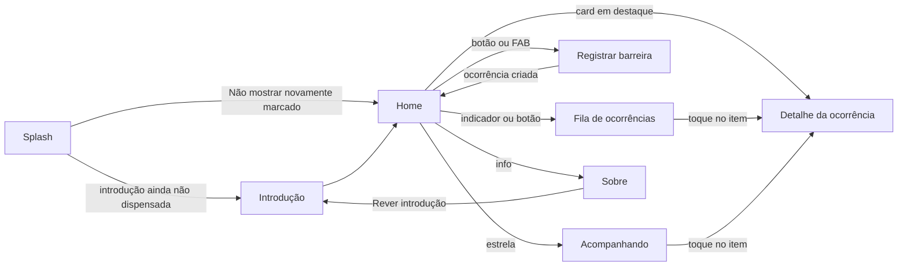

| Tela | Rota | Parâmetro recebido |
|---|---|---|
| Splash | `/` | — |
| Introdução | `/introducao` | `bool` (aberta pela tela Sobre) |
| Home | `/home` | — |
| Fila de ocorrências | `/ocorrencias` | `StatusOcorrencia?` (filtro inicial vindo dos indicadores) |
| Detalhe da ocorrência | `/detalhe` | `Ocorrencia` selecionada |
| Registrar barreira | `/registrar` | — (devolve a `Ocorrencia` criada para a Home) |
| Acompanhando | `/acompanhando` | — |
| Sobre | `/sobre` | — |

## Prints das telas

| Splash | Introdução (página 1) | Introdução (página 2) |
|---|---|---|
| 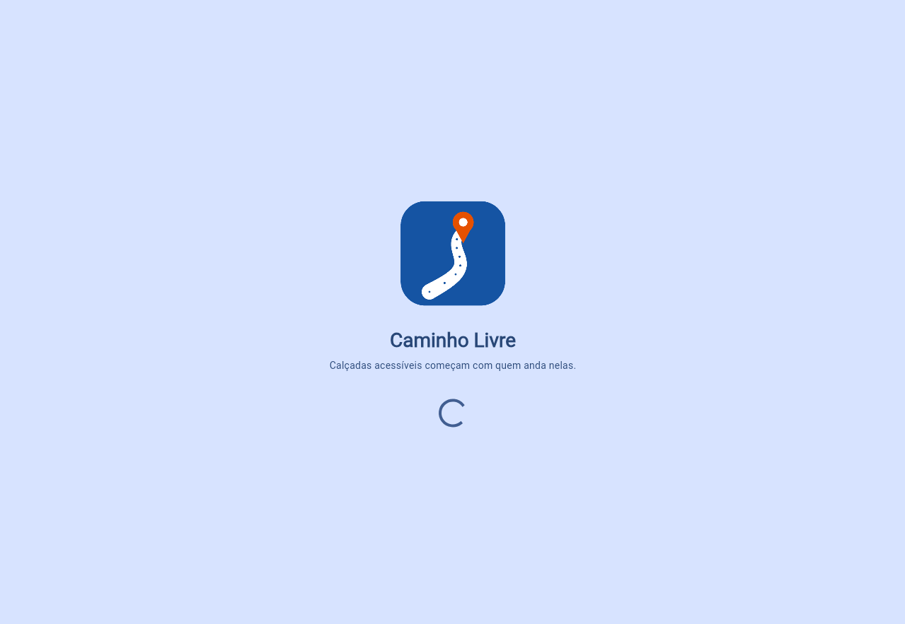 | 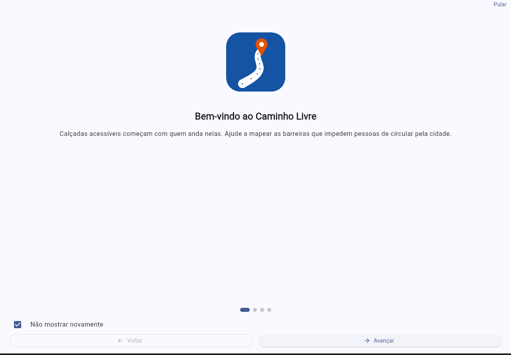 | 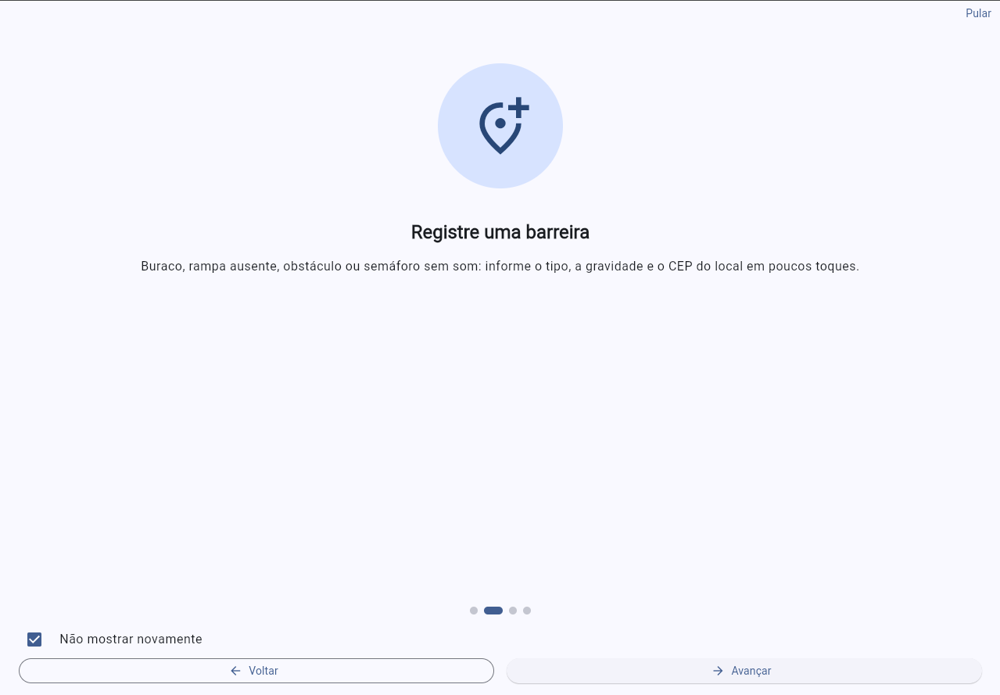 |

| Home | Fila de ocorrências | Detalhe da ocorrência |
|---|---|---|
| 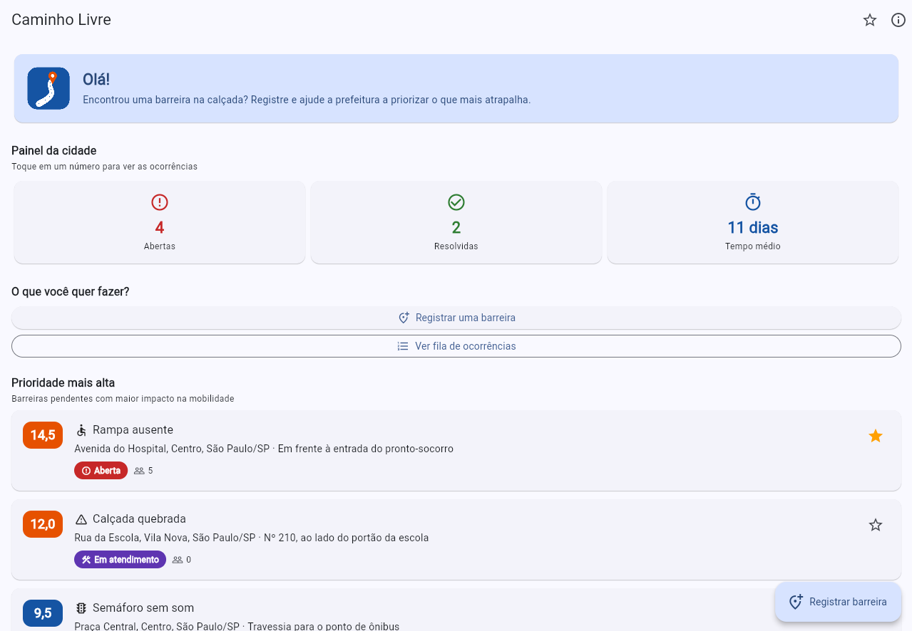 | 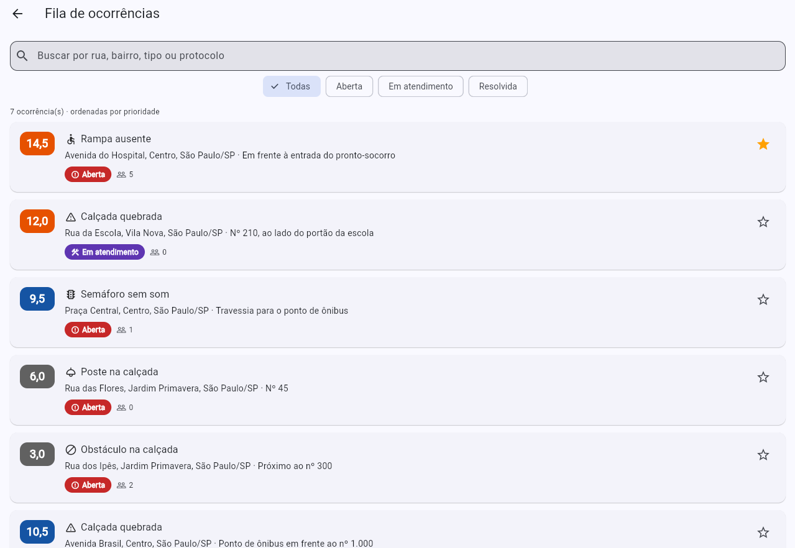 | 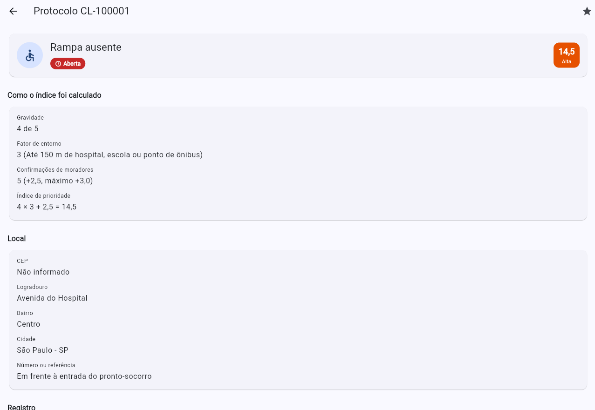 |

| Registrar barreira | Registrar (erro de CEP) | Acompanhando |
|---|---|---|
| 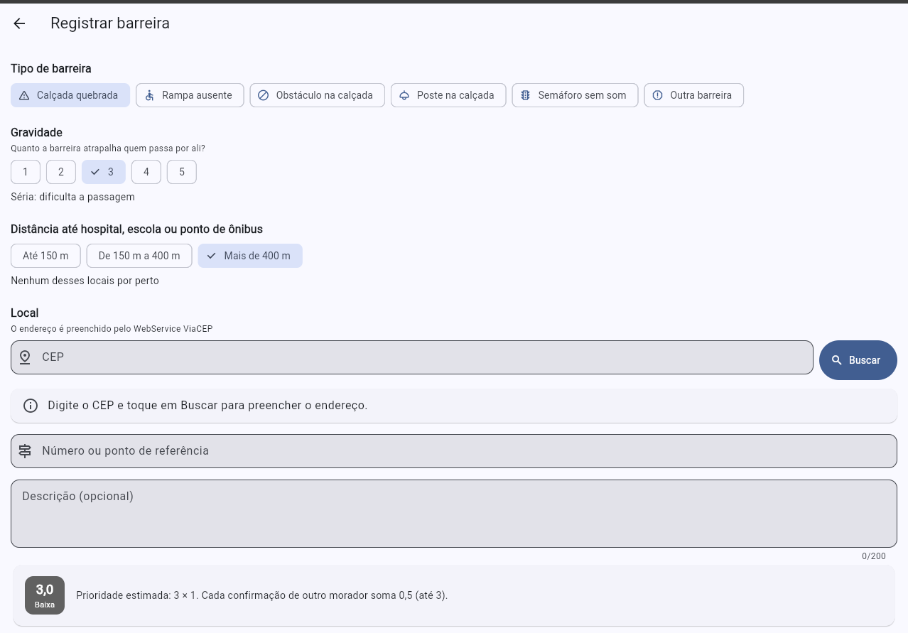 | 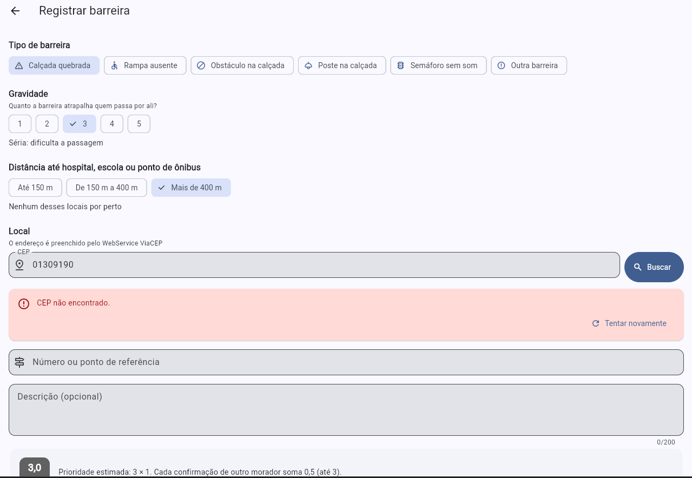 | 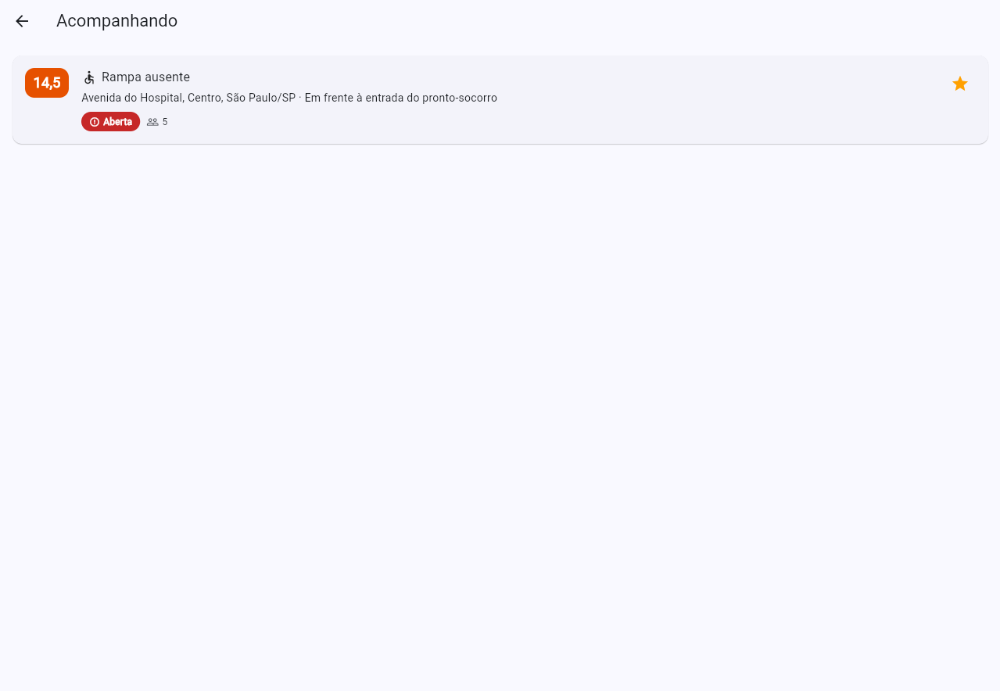 |

| Sobre |
|---|
| 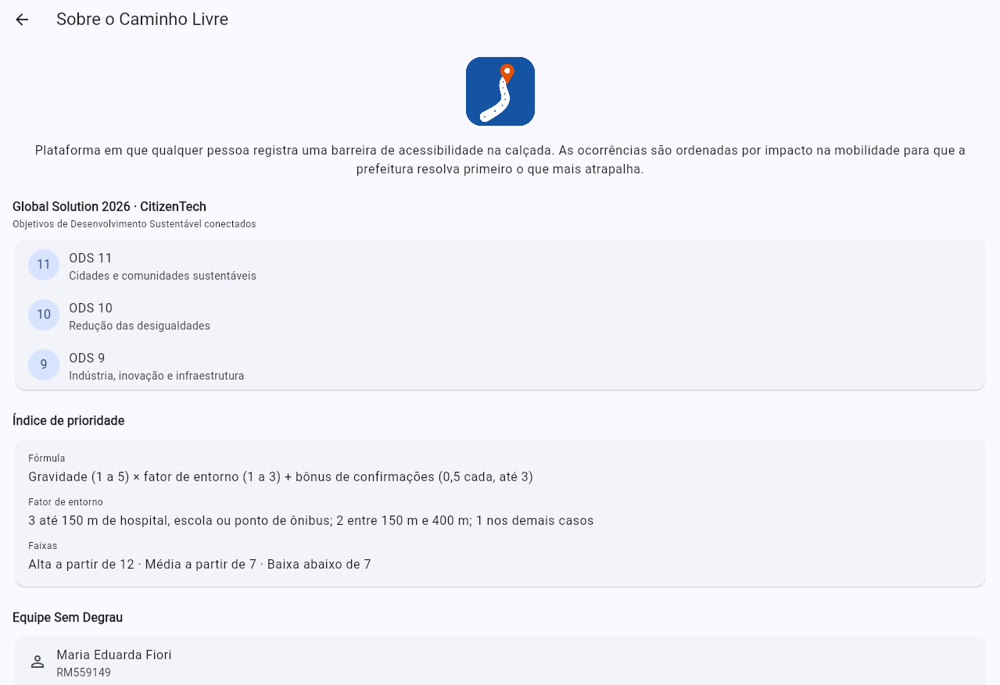 |

## API utilizada

**ViaCEP** — `https://viacep.com.br/ws/{cep}/json/`

- Requisição feita com o pacote `http` em `lib/data/viacep_service.dart`.
- O JSON é convertido no modelo `Endereco` (`Endereco.fromJson`).
- Estados tratados na tela de registro (`EstadoConsulta`): **inicial**, **carregando**, **sucesso** e **erro**.
- Erros tratados: CEP com menos de 8 dígitos, CEP inexistente (`"erro": true`), código HTTP diferente de 200, tempo esgotado e falta de conexão. Em todos aparece a mensagem e o botão **Tentar novamente**.

## Arquitetura

```
lib/
├── main.dart                 # MaterialApp, tema e rotas
├── core/                     # rotas, tema, cores, assets, formatadores e validadores
├── model/                    # modelos e enums (Endereco, Ocorrencia, StatusOcorrencia...)
├── prioridade/               # regra de negócio do índice (CalculadoraPrioridade)
├── data/                     # acesso a dados: ViaCEP, SharedPreferences e repositório
├── components/               # widgets reutilizáveis (cards, badges, chips, seletores)
└── screens/                  # telas do aplicativo
test/
├── prioridade/               # testes da regra de prioridade
├── model/                    # JSON, filtro, ordenação e indicadores
├── data/                     # ViaCEP (com MockClient) e repositório (SharedPreferences mock)
└── widget_test.dart          # testes dos componentes
```

- **Telas** (`screens/`) só cuidam da interface e do estado com `setState`.
- **Regras de negócio** ficam fora dos widgets: `CalculadoraPrioridade`, `FiltroOcorrencias`, `Indicadores` e `Validadores`.
- **Acesso a dados** fica em `data/`: `ViaCepService` (WebService), `PreferenciasService` (introdução) e `OcorrenciaRepository` (ocorrências salvas em JSON no SharedPreferences).
- **Componentes reutilizados**: `OcorrenciaCard` (Home, Fila e Acompanhando), `ErroCard` (CEP e listas), `InfoLinha` (endereço, detalhe e sobre), `PrioridadeBadge`, `StatusChip`, `SecaoTitulo`, `EstadoVazio`, `LogoApp`.
- **Navegação** com rotas nomeadas e `onGenerateRoute` (`core/app_routes.dart`), passando parâmetros por `arguments`.

### Pacotes

| Pacote | Uso |
|---|---|
| `http` | Consumo do ViaCEP |
| `shared_preferences` | Preferência da introdução e ocorrências salvas no aparelho |

## Como executar

Pré-requisito: Flutter instalado (`flutter doctor` sem erros).

```bash
# 1. Clonar o repositório
git clone https://github.com/Mai0n/caminho_livre_flutter.git
cd caminho_livre_flutter

# 2. Baixar as dependências
flutter pub get

# 3. Rodar os testes
flutter test

# 4. Executar no emulador Android ou celular
flutter run
```

O `android/app/src/main/AndroidManifest.xml` já inclui a permissão de internet, necessária para o ViaCEP.

Para gravar o vídeo com os dados de exemplo, use **Sobre → Restaurar dados de demonstração**.

## Links

- Repositório: https://github.com/Mai0n/caminho_livre_flutter
